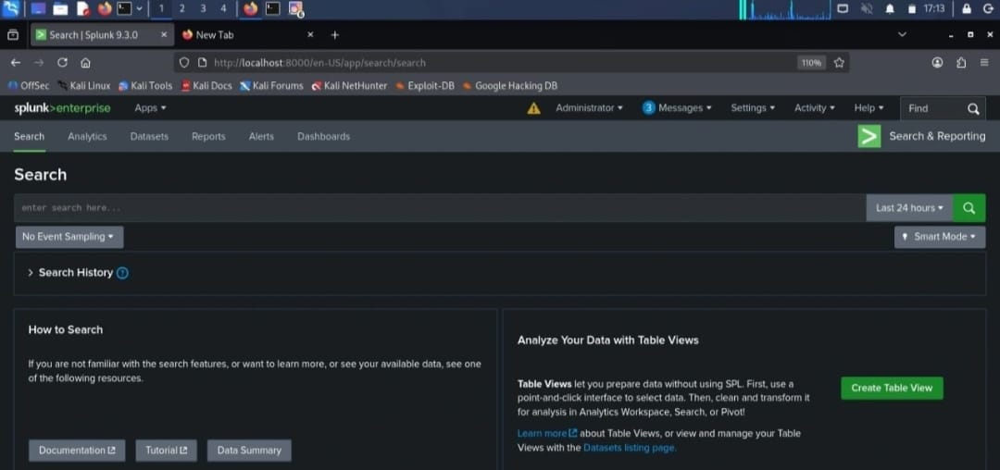
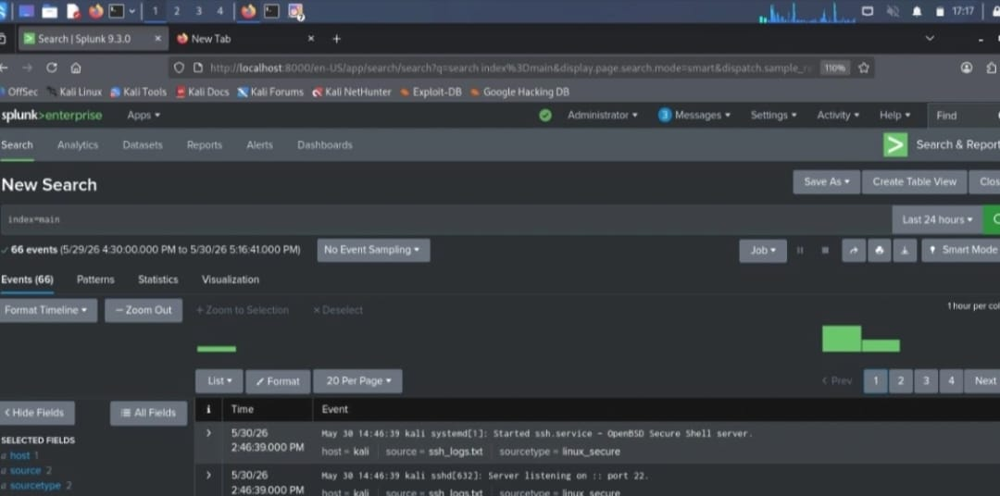
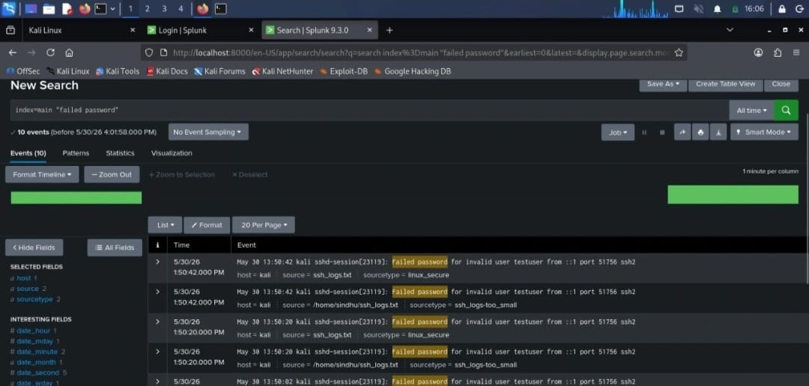
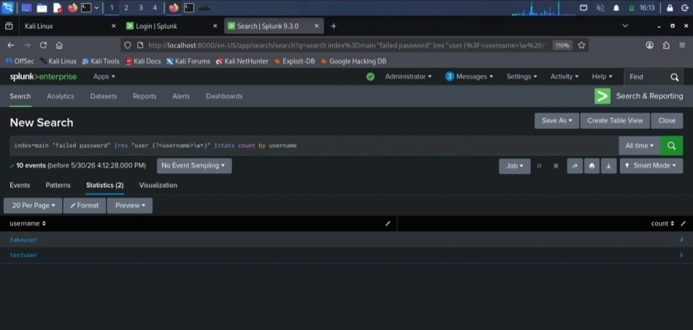
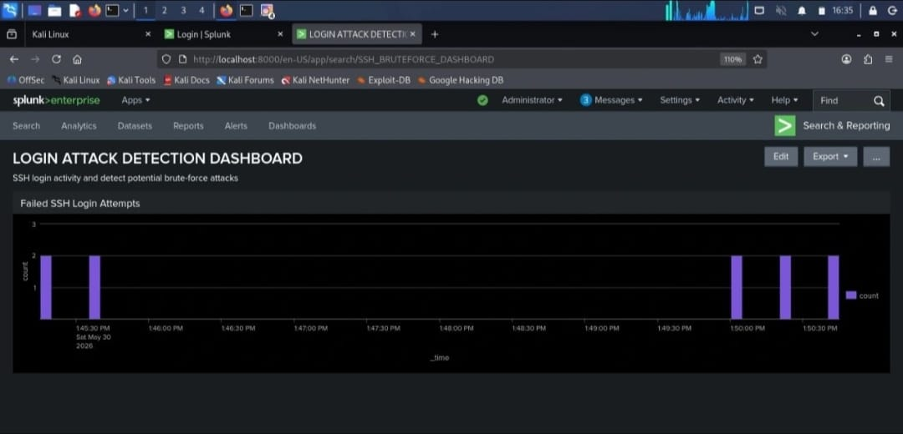
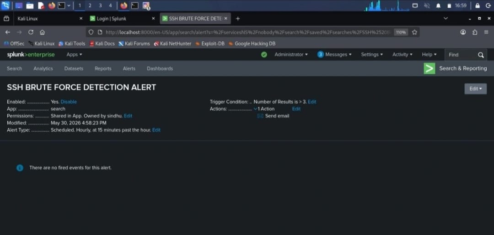

# SSH Brute Force Attack Detection using Splunk SIEM
Detecting SSH brute force attacks (MITRE ATT&CK T1110) with Splunk SIEM using SPL searches, alerts and dashboards.
## Overview
This project detects SSH brute force attacks by analysing Linux authentication logs in Splunk. Failed SSH login attempts are collected, parsed, grouped by source IP and compared against a threshold. Sources that cross the threshold trigger an alert and appear on a dashboard for investigation.

## Architecture
Linux SSH auth logs -> Splunk ingestion -> SPL search -> Alert -> Dashboard

## Tech stack
- Splunk Enterprise (SIEM)
- Linux (SSH authentication logs)
- SPL (Search Processing Language)
- MITRE ATT&CK framework

## Detection logic
The detection looks for many failed SSH logins from the same source in a short time.

spl
index=* sourcetype=linux_secure "Failed password"
rex "from (?<src_ip>\d{1,3}(?:\.\d{1,3}){3})"
bin _time span=5m
stats count AS failed_attempts BY _time, src_ip
where failed_attempts >= 5
sort - failed_attempts

**Technique:** T1110 Brute Force (Credential Access)
**Threshold:** 5 or more failed logins from one source IP within 5 minutes
**Output:** source IP, time window and number of failed attempts
## Screenshots
**Splunk search and results**

**Failed login analysis**

**Source IP breakdown**

**final result**

**Dashboard view**

**Alert configuration**

## Results
The search identified repeated failed SSH login attempts and grouped them by source IP.
Sources crossing the threshold were flagged and ranked by number of attempts.
The dashboard gives an analyst a quick view of which sources are attacking and how often.

## Investigation steps
1. Review the alert and note the source IP and time window.
2. Check whether any login from that IP succeeded after the failures (possible compromise).
3. Check how many different usernames were tried.
4. Block the source IP at the firewall if it is malicious.
5. Enforce key-based SSH authentication and use rate limiting such as fail2ban.

## What I learned
How to parse raw authentication logs and extract fields with `rex`.
How to build threshold-based detections with `stats`, `bin` and `where`.
How to turn a search into an alert and a dashboard.
How to map a detection to MITRE ATT&CK.

## Future improvements
Add a check for a successful login after repeated failures.
Enrich source IPs with geolocation and threat intelligence.
Tune thresholds to reduce false positives.

## Disclaimer
Lab use only. Do not test against systems you do not own or have permission to test. All IPs and usernames in the screenshots are from my own lab environment.
